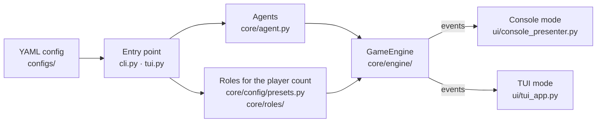

# Contributing

Contributions are welcome! You can participate in the following ways:

1. **Report Issues**: Report bugs or suggest features on the [Issues](https://github.com/Mai0313/LLMWereWolf/issues) page.
2. **Submit Pull Requests**: Fix bugs or add new features.
3. **Improve Documentation**: Help improve the README and code comments.
4. **Share Feedback**: Tell us about your experience using the project.

## Setup and Checks

```bash
uv sync --group test
uv run pytest
uv run pre-commit run -a
```

## Contribution Flow

1. Fork this project.
2. Create a feature branch (`git checkout -b feature/amazing-feature`).
3. Commit your changes (`git commit -m 'Add some amazing feature'`).
4. Push to the branch (`git push origin feature/amazing-feature`).
5. Open a Pull Request.

Pull request titles must follow [Conventional Commits](https://www.conventionalcommits.org/en/v1.0.0/); a CI check enforces it.

Please ensure your code:

- Follows the project's code style (using Ruff).
- Includes appropriate tests.
- Updates relevant documentation.

## Architecture

How a game is put together, from the config file to the screen (module paths are relative to `src/llm_werewolf/`):



## Capturing Screenshots

To capture TUI screenshots for documentation:

```bash
# Method 1: Using terminal screenshot tool
# Run the game in TUI mode and use your terminal's screenshot feature
uv run llm-werewolf-tui configs/demo.yaml

# Method 2: Using textual's screenshot feature (if available)
# The Textual framework may provide built-in screenshot capabilities

# Method 3: Using asciinema for terminal recording
asciinema rec werewolf-demo.cast
uv run llm-werewolf-tui configs/demo.yaml
# Press Ctrl+D to stop recording
```
